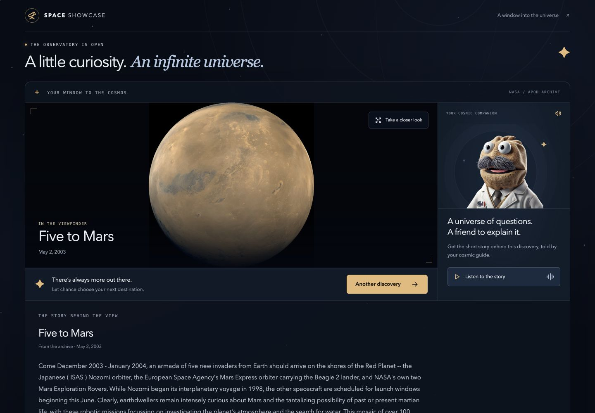

<div align="center">

# Space Showcase

### A little curiosity. An infinite universe.

A small observatory for discovering NASA imagery, with a talking cosmic companion to explain the view.

[**Enter the observatory ↗**](https://space-showcase.vercel.app/) · [Portfolio](https://www.son.moe)

[](https://space-showcase.vercel.app/)

</div>

## Explore

- **Let curiosity lead.** Discover a random image or video from NASA’s Astronomy Picture of the Day archive, dating back to June 1995.
- **Take a closer look.** Click anywhere in the image window to expand it, including the surrounding space. Escape returns you to the observation.
- **Hear the short story.** Request a brief, AI-generated astronomy narration. The original puppet mascot moves its mouth in response to the audio; pause and replay without generating it again.
- **Read the science.** Each observation includes its archive date, NASA explanation, available image credits, and original source link.
- **Settle into the observatory.** A dark sky, slow orbital rings and occasional shooting stars frame the imagery. Responsive layouts, keyboard controls and reduced-motion support keep exploration comfortable.

## Built with

| Area | Technology |
| --- | --- |
| Interface | React 18, Vite, React Icons |
| Visuals | Custom CSS, Tailwind CSS 3, CSS animations |
| Astronomy | NASA Science’s structured APOD feed, normalized by a server-side handler |
| Narration | OpenAI Realtime API, `gpt-realtime-2.1-mini`, Cedar voice |
| Playback | WAV audio, Web Audio API volume analysis for the puppet animation |
| Backend & hosting | Node.js Vercel Functions, outgoing WebSocket connection for narration, Vercel hosting |
| Checks | ESLint, Node.js built-in test runner |

### How an observation works

1. The browser chooses an archive date and requests `/api/nasa?date=YYYY-MM-DD`.
2. The server fetches NASA’s entry, normalizes its image/video source, and returns plain text with metadata. Bounded retries and caching handle upstream delays.
3. When you press **Listen to the story**, `/api/generateTTS` sends the supplied astronomy facts to Realtime Mini. A single request summarizes and speaks the explanation, returning a short WAV.
4. The browser plays that audio and uses its volume to animate the mascot. The generated audio is reused for that observation until you choose another discovery.

The current NASA feed needs **no NASA API key**. Narration uses a server-side `OPENAI_API_KEY`; the browser receives neither that credential nor access to your microphone. The older `api/rewriteExplanation.js` route remains in the repository, but the current app does not use the former separate rewrite-and-TTS flow.

## Run locally

Use a current Node.js LTS release and npm. For the complete app, use Vercel CLI so the `/api` functions run alongside the frontend.

```bash
git clone https://github.com/moe1011/SpaceShowcase.git
cd SpaceShowcase
npm ci
cp .env.example .env.local
```

Set `OPENAI_API_KEY` in `.env.local` to enable narration, then start the app:

```bash
npx vercel dev
```

Follow the CLI prompts to link or create your Vercel project. If you already have access to its development environment variables, you can use `vercel env pull .env.local` instead of copying the example.

Photos still work without an OpenAI key; the narration control reports that audio is not configured. `npm run dev` runs the Vite frontend alone and does not serve the `/api` handlers.

### Checks

```bash
npm run lint
npm test
npm run build
```

Tests cover APOD date validation and media normalization, narration event handling, WAV encoding, cancellation, timeouts and audio limits. They use mocked narration sockets and do not make paid API calls.

### Deploy

Import the repository into Vercel and add `OPENAI_API_KEY` to the desired deployment environments. The Vite build outputs to `dist`; Vercel serves the Node functions from `api/`. The narration function’s 30-second duration is configured in `vercel.json`.

```bash
npx vercel --prod
```

## Project map

```text
src/
  components/       Observation viewer, mascot, star field and footer
  hooks/            Observation lifecycle and audio playback/analysis
  index.css         Observatory visual system and responsive layouts
api/
  nasa.js           NASA feed proxy, caching and bounded retries
  generateTTS.js    Narration endpoint
lib/
  apod.js           Feed normalization and validation
  narration.js      Realtime session lifecycle and PCM-to-WAV conversion
tests/              API normalization and narration regression tests
docs/               Migration notes and design reference
```

## Credits

Built by [Mohammed Abdulla](https://www.son.moe). Astronomy imagery and explanations come from [NASA APOD](https://science.nasa.gov/apod/archive/); individual observations retain their available source credits. Preview image: NASA / USGS / Viking Project. Narration is generated with OpenAI.
